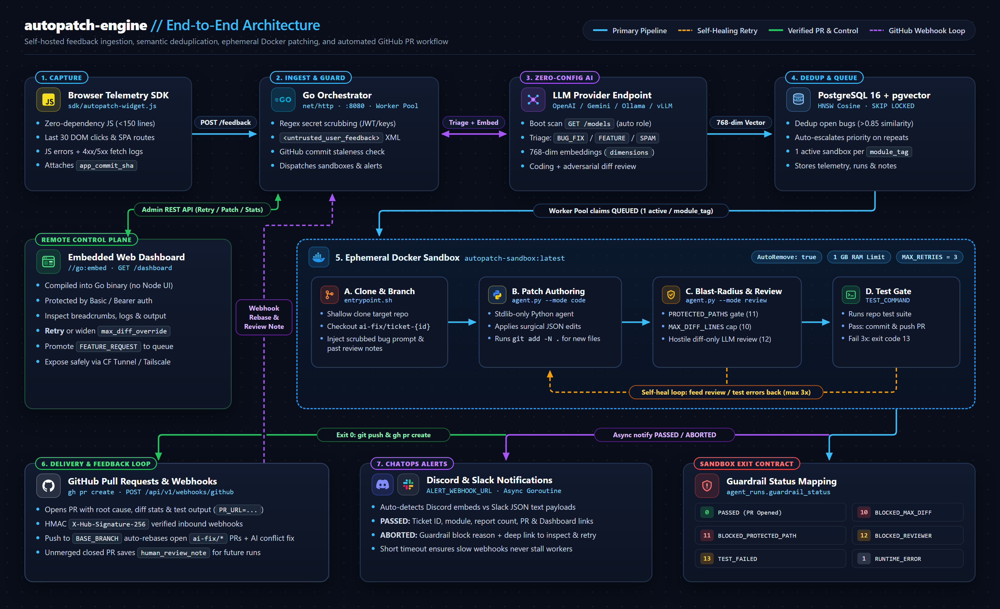

# autopatch-engine

[](https://github.com)
[](https://go.dev/)
[](https://github.com/pgvector/pgvector)
[](https://www.docker.com/)
[](#zero-config-model-auto-discovery)
[](#remote-control-plane--admin-api)

Self-hosted, autonomous **Feedback-to-PR DevOps engine** built with Go, PostgreSQL (`pgvector`), and ephemeral Docker sandboxes.

`autopatch-engine` captures real-time bug reports and browser telemetry from any web application, scrubs secrets, screens for prompt injection, deduplicates semantically similar issues in `pgvector`, patches verified bugs inside isolated single-use Docker containers behind strict blast-radius and regression-test guardrails, and opens review-ready GitHub Pull Requests automatically.

> **[Vietnamese Documentation](docs/README.vi.md)**

---

> [!WARNING]
> **Active Development — Use at Your Own Risk.**
> This project is currently under active development and has not undergone a formal security audit. It mounts the host Docker socket (`/var/run/docker.sock`) to spawn ephemeral containers and executes LLM-generated code patches and test commands against target repositories. It is **not 100% production-safe**. Always enforce GitHub branch protection rules, configure `PROTECTED_PATHS` and `MAX_DIFF_LINES`, require human review before merging any `ai-fix/*` Pull Request, and avoid deploying directly against unisolated production infrastructure.

---

## Architecture & Workflow



### Pipeline Overview

1. **Client Capture (`sdk/autopatch-widget.js`)**: A zero-dependency browser script (<150 lines) records the last 30 DOM clicks and SPA route transitions, uncaught JS errors, failed 4xx/5xx `fetch` calls (metadata only), device info, and `app_commit_sha`.
2. **Ingestion & Security Gate (`orchestrator`)**: `POST /api/v1/feedback` strips JWTs, API keys, passwords, and email addresses via regex before storage or model calls, isolates user input inside `<untrusted_user_feedback>` XML boundaries during triage, and skips bugs reported on outdated commits when the affected module has already changed on `BASE_BRANCH`.
3. **Semantic Deduplication & Module Locking (`pgvector`)**: Incoming bug reports are embedded into 768-dimensional vectors and matched against open tickets (`QUEUED`, `RUNNING`, `PR_OPENED`) via HNSW cosine similarity. Duplicates increment `occurrence_count` and escalate priority (`HIGH` at 3, `CRITICAL` at 5). Background workers claim tickets with `SELECT ... FOR UPDATE SKIP LOCKED` while enforcing at most one active sandbox or open PR per `module_tag`.
4. **Ephemeral Sandbox & Self-Healing Loop (`sandbox-runner`)**: Each claimed ticket spawns a disposable container (`AutoRemove: true`, 1 GB RAM) that shallow-clones the target repository, runs a stdlib-only Python coding agent (`agent.py --mode code`), enforces `PROTECTED_PATHS` and `MAX_DIFF_LINES` gates, passes the diff through an adversarial Senior Engineer LLM review (`agent.py --mode review`), and verifies `TEST_COMMAND` (up to 3 self-healing retries).
5. **PR Delivery, Webhooks & ChatOps Alerts**: Verified patches are pushed to `ai-fix/ticket-{id}` and opened as GitHub Pull Requests containing root-cause analysis and test output. Inbound GitHub webhooks (`X-Hub-Signature-256`) auto-rebase open `ai-fix/*` PRs when `BASE_BRANCH` advances and capture `human_review_note` from rejected PRs so future runs on the same module avoid repeating mistakes. Asynchronous webhooks notify Discord or Slack on both `PASSED` and `ABORTED` outcomes.

---

## Projected Time-Savings Benchmark

The table below estimates active engineering time for a typical **single-module web application bug** (for example, a null dereference, broken form handler, or API response parsing error in a repository with an automated test suite) from user report to merged Pull Request.

> [!NOTE]
> These figures are projected workflow estimates based on standard engineering triage and fix cycles, not laboratory telemetry. Actual gains depend on test-suite speed, codebase modularity, and model accuracy.

| Lifecycle Stage | Manual Engineering Workflow | With `autopatch-engine` | Active Engineer Time Saved |
|---|---|---|---|
| **1. Ticket Intake, Secret Cleanup & Deduplication** | 10–15 min (triage queue, merge duplicates, assign priority) | Automated (< 5 sec via triage + `pgvector` HNSW) | **~100%** (10–15 min) |
| **2. Telemetry Gathering & Reproduction** | 15–30 min (follow up with user for steps, console logs, failing endpoint, version) | Automated (widget attaches 30 breadcrumbs, JS errors, 4xx/5xx fetch logs, commit SHA) | **~100%** (15–30 min) |
| **3. Root Cause Investigation & Patch Authoring** | 25–45 min (locate module, write fix, handle edge cases) | Automated (1–3 min inside ephemeral Docker sandbox) | **~100%** (25–45 min) |
| **4. Regression Testing & Self-Review** | 10–15 min (run test suite locally, audit diff for regressions) | Automated (1–2 min; blast-radius gate + adversarial diff review + `TEST_COMMAND`) | **~100%** (10–15 min) |
| **5. PR Creation & Rebase Maintenance** | 10–15 min (write PR summary, rebase after `main` advances) | Automated (`gh pr create` + webhook auto-rebase & AI conflict resolution) | **~100%** (10–15 min) |
| **6. Human Code Review & Merge** | 15–20 min (peer review, CI verification, merge) | **10–15 min** (mandatory human review of pre-tested, diff-capped PR) | **~25%** (5 min) |
| **Total Active Engineer Time** | **85–140 min / bug** | **10–15 min / bug** | **~80%–88% reduction** |
| **Wall-Clock Time to Review-Ready PR** | **70–120 min** (plus queue wait) | **3–6 min** (automated end-to-end) | **~90%+ faster turnaround** |

### Practical Expectations by Scenario

- **High-impact fit (estimated 80%+ active time saved)**: Scoped UI/state bugs, input validation defects, null-pointer crashes, and serialization issues in repositories with fast, reliable automated tests.
- **Guardrail-blocked runs (`BLOCKED_MAX_DIFF`, `BLOCKED_REVIEWER`, `TEST_FAILED`)**: Even when the agent cannot pass all gates within 3 attempts, the engineer still avoids manual intake, deduplication, and reproduction (~25–45 min saved) and can inspect full telemetry and sandbox logs or retry with a larger `max_diff_override` directly from `/dashboard`.
- **Poor fit**: Architectural refactors, database schema migrations, cross-repository breaking changes, or codebases lacking automated regression tests.

---

## Key Capabilities

### Zero-Config Model Auto-Discovery
Provide only `LLM_BASE_URL` and `LLM_API_KEY`. On startup, the orchestrator normalizes provider URLs (for example, appending `/v1beta/openai` for `generativelanguage.googleapis.com` or `/v1` for local Ollama/vLLM ports `11434`/`8000`), queries `GET {LLM_BASE_URL}/models`, and scores available models into three roles:
- **Embedding (`EMBEDDING_MODEL=auto`)**: Prioritizes `text-embedding-004`, `nomic-embed-text`, `text-embedding-3-small`, `bge`, and `mxbai` models, automatically passing `"dimensions": VECTOR_DIM` (`768`) to match PostgreSQL `VECTOR(768)` (with automatic fallback for endpoints that reject the `dimensions` field).
- **Triage (`TRIAGE_MODEL=auto`)**: Selects fast, low-cost models (`flash`, `mini`, `haiku`, `nano`, `3b`–`8b`).
- **Coding & Review (`CODING_MODEL=auto`)**: Selects high-capability or coding-specialized models (`coder`, `pro`, `sonnet`, `opus`, `gpt-4o`, `deepseek`, `qwen`, `32b`/`70b`) and forwards the resolved concrete model ID into every sandbox container.

Any slot can still be pinned explicitly in `.env` to bypass auto-discovery for that role.

### Remote Control Plane & Admin API
A responsive single-file Web Dashboard is compiled directly into the Go binary via `//go:embed`—no Node.js build step or extra frontend container is required.

- **Web Dashboard (`GET /dashboard`)**: Live KPI cards (Total Tickets, Open PRs, Merge Rate, Blocked/Failed), 10-second auto-refresh, status filter tabs (`ALL`, `QUEUED`, `RUNNING`, `PR_OPENED`, `MERGED`, `ABORTED`, `FEATURE_REQUEST`, `IGNORED_OUTDATED`), and a slide-over detail drawer showing breadcrumbs, console errors, network logs, sandbox `test_output`, and `human_review_note`.
- **Direct Interventions**: Retry failed tickets, retry with a per-ticket `max_diff_override` (overriding `MAX_DIFF_LINES` for complex fixes), promote `FEATURE_REQUEST` tickets into `QUEUED`, update ticket priority, or dismiss/abort tickets.

| Method & Endpoint | Auth | Description |
|---|---|---|
| `GET /dashboard` | Admin Auth* | Embedded responsive Web Dashboard |
| `GET /api/v1/tickets` | Admin Auth* | Paginated tickets joined with latest `agent_runs` and `ticket_telemetry` (`?status=&limit=&offset=`) |
| `GET /api/v1/stats` | Admin Auth* | Aggregated ticket counts and `merged_rate_percent` |
| `POST /api/v1/tickets/{id}/retry` | Admin Auth* | Requeues `ABORTED` or `IGNORED_OUTDATED` tickets; optional JSON `{"max_diff_override": 500}` |
| `PATCH /api/v1/tickets/{id}` | Admin Auth* | Manually updates `status` and/or `priority` (`LOW`, `MEDIUM`, `NORMAL`, `HIGH`, `CRITICAL`) |
| `POST /api/v1/feedback` | Public (CORS) | Client widget ingestion endpoint |
| `POST /api/v1/webhooks/github` | HMAC-SHA256 | GitHub `push` (auto-rebase) and `pull_request` (merge/rejection feedback loop) handler |
| `GET /healthz` | Public | Database connectivity healthcheck |

\*When `ADMIN_PASSWORD` is configured, all Admin endpoints require either HTTP Basic Auth (`ADMIN_USER` / `ADMIN_PASSWORD`) or `Authorization: Bearer <ADMIN_PASSWORD>`.

---

## Quickstart

### Prerequisites
- Docker Engine and Docker Compose v2+ (`docker compose`)
- `make` (or `mingw32-make` on Windows; direct `docker compose` commands also work)
- A target GitHub repository (`TARGET_REPO_URL`) with a working automated test command (`TEST_COMMAND`)
- A fine-grained GitHub PAT (`GITHUB_TOKEN`) with `Contents: Read & Write` and `Pull Requests: Read & Write`
- An OpenAI-compatible LLM endpoint (`LLM_BASE_URL`) and key (`LLM_API_KEY`)

### 1. Clone and Initialize `.env`
```bash
git clone <your-repo-url> autopatch-engine
cd autopatch-engine
make init
```

Edit `.env` with your target repository, GitHub token, test command, and LLM endpoint:
```env
TARGET_REPO_URL=https://github.com/your-org/your-app.git
GITHUB_TOKEN=ghp_your_github_token_here
GITHUB_WEBHOOK_SECRET=your_webhook_secret_here
BASE_BRANCH=main

# Match the runtime of your target repository (e.g., node:20-slim, golang:1.23-bookworm, python:3.12-slim)
SANDBOX_BASE_IMAGE=node:20-slim
TEST_COMMAND=npm test

# Zero-config AI: provide URL + key; EMBEDDING_MODEL / TRIAGE_MODEL / CODING_MODEL default to "auto"
# OpenAI: https://api.openai.com/v1
# Gemini: https://generativelanguage.googleapis.com   (auto-appends /v1beta/openai)
# Ollama: http://host.docker.internal:11434           (auto-appends /v1)
# vLLM:   http://host.docker.internal:8000            (auto-appends /v1)
LLM_BASE_URL=https://api.openai.com/v1
LLM_API_KEY=sk-your-api-key-here

# Recommended: protect /dashboard and Admin API
ADMIN_USER=admin
ADMIN_PASSWORD=change-this-strong-password

# Optional: Discord or Slack webhook notifications
ALERT_WEBHOOK_URL=
PUBLIC_DASHBOARD_URL=https://autopatch.your-domain.com/dashboard
```

### 2. Build and Start the Stack
```bash
make up
```
This initializes PostgreSQL 16 with `pgvector`, builds `autopatch-sandbox:latest`, compiles the Go orchestrator (with the embedded dashboard), resolves models on startup, and listens on `http://localhost:8080`.

### 3. Verify End-to-End
```bash
curl -fsS http://localhost:8080/healthz
make demo-feedback
make logs
```
Open `http://localhost:8080/dashboard` in your browser to monitor tickets, inspect telemetry, and review sandbox runs.

---

## Client Telemetry SDK

Embed `sdk/autopatch-widget.js` into any web application with a single script tag:

```html
<script>
  window.__APP_COMMIT_SHA__ = "deadbeef1234567890";
</script>
<script
  src="/sdk/autopatch-widget.js"
  data-endpoint="https://autopatch.your-domain.com/api/v1/feedback"
  data-label="Report Bug"
  data-accent="#2563eb"
  data-position="bottom-right">
</script>
```

Options can alternatively be provided through `window.AUTOPATCH_CONFIG = { endpoint, label, accent, position }`. Failed `fetch` tracking records only `method`, `url` (stripped of embedded credentials), `status`, and `duration_ms`—never request/response headers or bodies.

---

## Remote Exposure, Webhooks & Security Hardening

1. **Do Not Expose Port `8080` Directly**: Place the orchestrator behind **[Cloudflare Tunnel](https://developers.cloudflare.com/cloudflare-one/connections/connect-networks/)** (with **Cloudflare Access** policies protecting `/dashboard`, `/api/v1/tickets*`, and `/api/v1/stats`) or **[Tailscale](https://tailscale.com/)** for private engineer-only administration while exposing only `/api/v1/feedback` and `/api/v1/webhooks/github` as needed.
2. **Enable Admin Authentication**: Always set a strong `ADMIN_PASSWORD` in `.env` when running outside localhost.
3. **Configure GitHub Webhooks**: In your target repository (**Settings -> Webhooks -> Add webhook**), set Payload URL to `https://<your-domain>/api/v1/webhooks/github`, Content type to `application/json`, Secret to `GITHUB_WEBHOOK_SECRET`, and subscribe to **Pushes** and **Pull requests**.
4. **ChatOps Webhooks**: Set `ALERT_WEBHOOK_URL` to a Discord webhook (`discord.com/api/webhooks/...`) or Slack incoming webhook URL. Alerts are dispatched asynchronously with a 5-second timeout so outbound network failures never stall sandbox workers.
5. **Air-Gapped / Zero Data Retention Mode**: Point `LLM_BASE_URL` at a self-hosted Ollama or vLLM instance so proprietary source code and user telemetry never leave your network.

---

## Configuration Reference

| Variable | Default | Description |
|---|---|---|
| `TARGET_REPO_URL` | *(required)* | HTTPS clone URL of the repository to patch |
| `GITHUB_TOKEN` | *(required)* | GitHub PAT (`Contents` & `Pull Requests` read/write) |
| `GITHUB_WEBHOOK_SECRET` | `""` | HMAC-SHA256 secret for `POST /api/v1/webhooks/github` |
| `BASE_BRANCH` | `main` | Target branch for PRs, staleness checks, and auto-rebasing |
| `SANDBOX_BASE_IMAGE` | `node:20-slim` | Base Docker image used to build `autopatch-sandbox:latest` |
| `LLM_BASE_URL` | `https://api.openai.com/v1` | OpenAI-compatible base URL (auto-normalized for Gemini/Ollama/vLLM) |
| `LLM_API_KEY` | `""` | Provider API key (any non-empty placeholder works for local Ollama) |
| `EMBEDDING_MODEL` | `auto` | Embedding model ID or `auto` for startup discovery |
| `TRIAGE_MODEL` | `auto` | Triage classifier model ID or `auto` for startup discovery |
| `CODING_MODEL` | `auto` | Coding & adversarial review model ID or `auto` for startup discovery |
| `VECTOR_DIM` | `768` | Embedding dimensionality matching `VECTOR(768)` in `init.sql` |
| `SIMILARITY_THRESHOLD` | `0.85` | Cosine similarity cutoff for semantic deduplication |
| `PROTECTED_PATHS` | `.env,docker-compose.yml,.github/workflows` | Comma-separated path prefixes forbidden from modification |
| `MAX_DIFF_LINES` | `200` | Default maximum added + deleted lines per automated patch |
| `TEST_COMMAND` | `npm test` | Regression test command executed inside the sandbox |
| `ADMIN_USER` | `admin` | Username for HTTP Basic Auth on Admin endpoints |
| `ADMIN_PASSWORD` | `""` | Password/Bearer token protecting `/dashboard` and Admin REST API |
| `ALERT_WEBHOOK_URL` | `""` | Optional Discord or Slack webhook URL for completion alerts |
| `PUBLIC_DASHBOARD_URL` | `""` | Optional public dashboard URL embedded in ChatOps alerts |
| `CORS_ALLOWED_ORIGIN` | `*` | Allowed origin for `POST /api/v1/feedback` |
| `ORCHESTRATOR_PORT` | `8080` | Host HTTP port exposed by Docker Compose |

---

## Sandbox Runtime Contract

### Injected Environment Variables
`TICKET_ID`, `BUG_PROMPT`, `TARGET_REPO_URL`, `GITHUB_TOKEN`, `BASE_BRANCH`, `LLM_BASE_URL`, `LLM_API_KEY`, `CODING_MODEL`, `PROTECTED_PATHS`, `MAX_DIFF_LINES`, `TEST_COMMAND`

### Container Exit Code Mapping (`agent_runs.guardrail_status`)

| Exit Code | `guardrail_status` | Meaning |
|---|---|---|
| `0` | `PASSED` | All gates passed; PR opened (`PR_URL=<url>` printed on final non-empty stdout line) |
| `10` | `BLOCKED_MAX_DIFF` | Total added + deleted lines exceeded `MAX_DIFF_LINES` (or `max_diff_override`) |
| `11` | `BLOCKED_PROTECTED_PATH` | Patch modified a file matching `PROTECTED_PATHS` |
| `12` | `BLOCKED_REVIEWER` | Adversarial Senior Engineer reviewer rejected the diff across all retries |
| `13` | `TEST_FAILED` | `TEST_COMMAND` failed across all retries |
| `1` | `RUNTIME_ERROR` | Repository clone, LLM API, git, or `gh` CLI error |

---

## Repository Structure

```text
.
├── .env.example                 # Single-file configuration template
├── .gitignore                   # Ignore rules for secrets, build artifacts, and IDE files
├── docker-compose.yml           # PostgreSQL (pgvector), Sandbox builder, and Go Orchestrator
├── init.sql                     # PostgreSQL 16 + pgvector schema and HNSW indexes
├── Makefile                     # Shortcuts: init, up, down, logs, demo-feedback
├── docs/
│   ├── workflow.png             # Rendered end-to-end architecture diagram
│   └── README.vi.md             # Vietnamese documentation
├── orchestrator/                # Go 1.26 service (HTTP API, worker pool, Docker SDK, embedded UI)
│   ├── Dockerfile
│   ├── go.mod
│   ├── main.go
│   └── internal/
│       ├── config/              # Env loader, validation, and LLM base URL normalization
│       ├── db/                  # pgx/v5 repository, pgvector dedup, SKIP LOCKED queue, migrations
│       ├── llm/                 # Secret scrubber, XML-isolated triage, embeddings, model discovery
│       ├── notify/              # Async Discord & Slack ChatOps webhook notifier
│       ├── sandbox/             # Docker Engine SDK runner & exit-code contract mapper
│       ├── web/                 # Single-file embedded Web Dashboard (//go:embed)
│       └── webhook/             # Feedback API, GitHub webhook/auto-rebase, Admin API & auth
├── sandbox-runner/              # Isolated execution container image
│   ├── Dockerfile               # Parameterized via ARG SANDBOX_BASE_IMAGE
│   ├── agent.py                 # Stdlib-only Python coding and adversarial review agent
│   └── entrypoint.sh            # Clone -> Fix -> Blast-Radius -> Review -> Test -> PR loop
└── sdk/
    └── autopatch-widget.js      # Zero-dependency browser telemetry & bug report widget
```

---

## Development, Testing & Windows Notes

### Running the Test Suite Offline
```bash
cd orchestrator
go vet ./...
go test -v -count=1 ./...
```
To include the live PostgreSQL `pgvector` integration tests (`internal/db`), point `TEST_DATABASE_URL` at a `pgvector/pgvector:pg16` instance initialized with `init.sql` and set `REQUIRE_DB_TESTS=1`.

### Validate Compose & Container Builds
```bash
docker compose config --quiet
docker compose build
```

### Windows Notes
- Ensure **Docker Desktop** is running in Linux container mode (`desktop-linux`).
- If `make` is unavailable on your `PATH`, use `mingw32-make` or run `copy .env.example .env` and `docker compose up -d --build` directly.
- In PowerShell, `curl` aliases `Invoke-WebRequest`; use `curl.exe` when posting raw JSON payloads.
- `sandbox-runner/Dockerfile` normalizes `CRLF` to `LF` and marks `agent.py` and `entrypoint.sh` executable during build.
