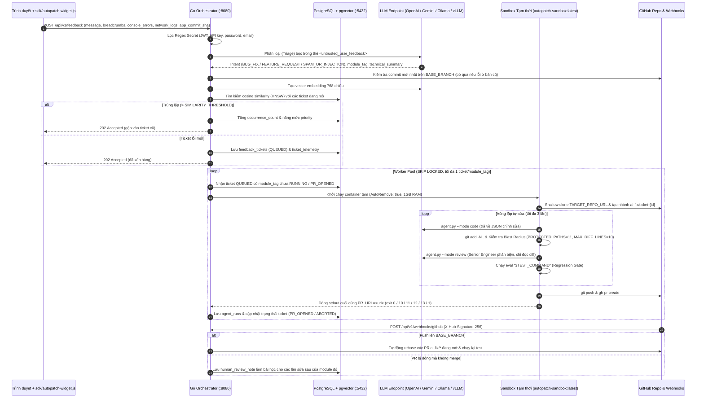

# autopatch-engine (Hướng dẫn Tiếng Việt)

**Bộ công cụ DevOps tự host chuyển đổi Feedback người dùng thành Pull Request tự động** — triển khai nhanh qua `git clone`, file `.env` và `make up`.

`autopatch-engine` thu thập báo lỗi và telemetry từ trình duyệt qua một widget JS không phụ thuộc thư viện ngoài, lọc dữ liệu nhạy cảm, chống prompt injection, gộp các báo lỗi trùng lặp ngữ nghĩa bằng PostgreSQL (`pgvector`), chạy Coding Agent trong Docker sandbox cô lập kèm kiểm soát bán kính ảnh hưởng (blast-radius) và regression test, sau đó tự động mở Pull Request trên GitHub.

---

## Kiến trúc & Luồng xử lý



---

## Yêu cầu chuẩn bị trước khi triển khai

1. **Docker Engine & Docker Compose v2+** (`docker compose`).
   - Trên Windows: bật **Docker Desktop** với chế độ **Linux containers (`desktop-linux`)**.
2. **`make`** (hoặc `mingw32-make` trên Windows, hoặc chạy trực tiếp lệnh `docker compose` nếu không cài `make`).
3. **Repository đích trên GitHub (`TARGET_REPO_URL`)**:
   - Đã có sẵn bộ test tự động tương ứng với `TEST_COMMAND` (ví dụ `npm test`, `pytest`, `go test ./...`).
   - Đã cấu hình sẵn `BASE_BRANCH` (thường là `main`).
4. **GitHub Personal Access Token (`GITHUB_TOKEN`)**:
   - Fine-grained PAT cấp quyền tối thiểu cho repo đích:
     - **Contents**: `Read and write`
     - **Pull requests**: `Read and write`
5. **LLM Endpoint tương thích chuẩn OpenAI (`LLM_BASE_URL`)**:
   - Hỗ trợ cả API cloud (OpenAI, Gemini OpenAI-compat) lẫn LLM nội bộ self-hosted (Ollama, vLLM).
   - **Lưu ý quan trọng về vector dimension**: bảng `feedback_tickets` trong `init.sql` dùng `VECTOR(768)`. Hãy chọn model embedding trả về đúng **768 chiều** (ví dụ `nomic-embed-text` trên Ollama, `text-embedding-004` trên Gemini, hoặc cấu hình endpoint hỗ trợ 768 chiều).

---

## Hướng dẫn triển khai từng bước (Quickstart)

### Bước 1: Tạo file cấu hình `.env`

Tại thư mục gốc dự án (`Auto Feedback`), chạy:

```bash
make init
```

*(Trên Windows không có `make`, dùng PowerShell/CMD: `copy .env.example .env`)*

Mở file `.env` và điền các thông số thực tế của bạn:

```env
# --- Repo đích & GitHub ---
TARGET_REPO_URL=https://github.com/your-org/your-app.git
GITHUB_TOKEN=ghp_xxxxxxxxxxxxxxxxxxxx
GITHUB_WEBHOOK_SECRET=chuoi_bi_mat_webhook_cua_ban
BASE_BRANCH=main

# --- Base Image cho Sandbox (khớp ngôn ngữ của repo đích) ---
# Node.js: node:20-slim | Go: golang:1.23-bookworm | Python: python:3.12-slim
SANDBOX_BASE_IMAGE=node:20-slim
SANDBOX_IMAGE=autopatch-sandbox:latest

# --- Nhà cung cấp LLM (Zero-Config Auto-Discovery) ---
# Chỉ cần điền LLM_BASE_URL và LLM_API_KEY; các hậu tố đường dẫn được tự chuẩn hóa:
#   OpenAI: https://api.openai.com/v1
#   Gemini: https://generativelanguage.googleapis.com   (tự nối /v1beta/openai)
#   Ollama: http://host.docker.internal:11434           (tự nối /v1)
#   vLLM:   http://host.docker.internal:8000            (tự nối /v1)
LLM_BASE_URL=https://api.openai.com/v1
LLM_API_KEY=sk-your-llm-api-key-here
# Để mặc định "auto" để tự quét GET {LLM_BASE_URL}/models và phân vai lúc khởi động
EMBEDDING_MODEL=auto
VECTOR_DIM=768
TRIAGE_MODEL=auto
CODING_MODEL=auto

# --- Kiểm soát rủi ro (Guardrails) ---
SIMILARITY_THRESHOLD=0.85
PROTECTED_PATHS=.env,docker-compose.yml,.github/workflows
MAX_DIFF_LINES=200
TEST_COMMAND=npm test

# --- Dashboard quản trị từ xa & ChatOps Alerts ---
ADMIN_USER=admin
ADMIN_PASSWORD=mat_khau_manh_cho_dashboard
ALERT_WEBHOOK_URL=
PUBLIC_DASHBOARD_URL=https://autopatch.your-domain.com/dashboard

# --- PostgreSQL & Orchestrator ---
POSTGRES_USER=autopatch
POSTGRES_PASSWORD=autopatch
POSTGRES_DB=autopatch
POSTGRES_HOST=db
POSTGRES_PORT=5432
ORCHESTRATOR_PORT=8080
```

> **Mẹo dùng Ollama local (Zero Data Retention)**:
> - Đặt `LLM_BASE_URL=http://host.docker.internal:11434/v1` và `LLM_API_KEY=ollama`.
> - Đảm bảo Ollama trên máy host cho phép kết nối từ Docker (ví dụ đặt biến môi trường `OLLAMA_HOST=0.0.0.0:11434`) và đã pull sẵn model embedding (`nomic-embed-text`) + coding model (như `qwen2.5-coder`).

---

### Bước 2: Build và khởi chạy toàn bộ Stack

```bash
make up
```

*(Hoặc chạy trực tiếp: `docker compose up -d --build`)*

Lệnh này sẽ khởi tạo 3 service trong `docker-compose.yml`:
1. `db` (`pgvector/pgvector:pg16`): tự động chạy `init.sql` tạo extension `vector` và 3 bảng `feedback_tickets`, `ticket_telemetry`, `agent_runs`.
2. `sandbox-builder`: build image `autopatch-sandbox:latest` từ `sandbox-runner/Dockerfile` theo `SANDBOX_BASE_IMAGE`.
3. `orchestrator`: build Go service từ `orchestrator/Dockerfile`, mount `/var/run/docker.sock` để gọi Docker daemon spawn sandbox, mở cổng `8080` (hoặc `ORCHESTRATOR_PORT`).

Kiểm tra trạng thái các container và healthcheck:

```bash
docker compose ps
curl -fsS http://localhost:8080/healthz
```

Nếu thành công, `/healthz` trả về HTTP `200` xác nhận orchestrator và PostgreSQL đã sẵn sàng.

---

### Bước 3: Gửi thử Feedback mẫu & xem Log

```bash
make demo-feedback
make logs
```

*(Trên Windows PowerShell, lưu ý `curl` là alias của `Invoke-WebRequest`, hãy dùng `curl.exe` khi gửi JSON thủ công).*

---

### Bước 4: Tích hợp Widget vào Web App của bạn (`sdk/autopatch-widget.js`)

Copy hoặc serve file `sdk/autopatch-widget.js` trên ứng dụng web của bạn và nhúng đoạn sau trước thẻ đóng `</body>`:

```html
<script>
  // Khuyến nghị truyền commit SHA hiện tại của bản deploy
  window.__APP_COMMIT_SHA__ = "deadbeef1234567890";
</script>
<script
  src="/sdk/autopatch-widget.js"
  data-endpoint="https://autopatch.your-domain.com/api/v1/feedback"
  data-label="Report Bug"
  data-accent="#2563eb"
  data-position="bottom-right">
</script>
```

Bạn cũng có thể cấu hình qua biến toàn cục:
```html
<script>
  window.AUTOPATCH_CONFIG = {
    endpoint: "https://autopatch.your-domain.com/api/v1/feedback",
    label: "Báo lỗi",
    accent: "#2563eb",
    position: "bottom-right"
  };
</script>
```

Widget tự động ghi nhận (không cần thư viện ngoài, < 150 dòng JS):
- **Breadcrumbs (30 sự kiện gần nhất)**: click nút/link và chuyển trang SPA (`pushState`, `replaceState`, `popstate`, `hashchange`).
- **Lỗi Runtime**: `window.onerror` và `unhandledrejection`.
- **API lỗi (10 request gần nhất)**: bọc `window.fetch` ghi nhận các request HTTP `>= 400` hoặc lỗi mạng (chỉ lưu `method`, `url`, `status`, `duration_ms`, không lưu payload/header nhạy cảm).

---

### Bước 5: Quản lý từ xa qua Embedded Dashboard & ChatOps Webhook

Toàn bộ Web Dashboard được nhúng trực tiếp vào binary Go qua `//go:embed` (không cần container Frontend riêng), truy cập tại `http://localhost:8080/dashboard`:
- **Bảo vệ truy cập**: Điền `ADMIN_USER` (mặc định `admin`) và `ADMIN_PASSWORD` trong `.env` để bật bắt buộc HTTP Basic Auth / `Authorization: Bearer <ADMIN_PASSWORD>` cho `/dashboard`, `/api/v1/tickets*` và `/api/v1/stats` (trong khi `/api/v1/feedback` vẫn mở công khai cho widget trình duyệt và `/api/v1/webhooks/github` vẫn xác thực `X-Hub-Signature-256`).
- **Khuyến nghị bảo mật khi mở ra ngoài**: Không mở trực tiếp port `8080` ra Internet; hãy dùng **Cloudflare Tunnel (kèm Cloudflare Access)** hoặc **Tailscale** để truy cập Dashboard an toàn từ điện thoại/máy từ xa.
- **Can thiệp trực tiếp trên Dashboard**: Xem đầy đủ breadcrumbs, console/network errors, log sandbox (`test_output`), bấm **Retry**, **Retry & nới giới hạn Diff** (`max_diff_override`), đẩy `FEATURE_REQUEST` vào hàng đợi (`QUEUED`), hoặc đóng/bỏ qua (`ABORTED`).
- **Thông báo đẩy Discord / Slack**: Điền `ALERT_WEBHOOK_URL` và `PUBLIC_DASHBOARD_URL` trong `.env` để tự động nhận thông báo bất đồng bộ khi sandbox mở PR thành công (`PASSED`) hoặc bị chặn/lỗi (`ABORTED`).

---

### Bước 6: Cấu hình GitHub Webhook (Để tự Rebase & học từ PR bị từ chối)

Để `orchestrator` nhận phản hồi ngược từ GitHub:
1. Mở repo GitHub đích -> **Settings -> Webhooks -> Add webhook**.
2. **Payload URL**: `https://<domain-cong-khai-cua-orchestrator>/api/v1/webhooks/github`
   *(Nếu test trên máy cá nhân, có thể expose cổng `8080` bằng ngrok hoặc Cloudflare Tunnel).*
3. **Content type**: `application/json`
4. **Secret**: điền đúng giá trị `GITHUB_WEBHOOK_SECRET` trong file `.env`.
5. **Events**: chọn **Let me select individual events** và tích đúng 2 event mà webhook handler xử lý:
   - **Pushes** (khi có push/merge lên `BASE_BRANCH`, hệ thống tự rebase các PR `ai-fix/*` đang mở)
   - **Pull requests** (khi PR `ai-fix/*` được merge sẽ đánh dấu `MERGED`; khi đóng mà không merge, hệ thống chủ động gọi GitHub API lấy review comments và lưu vào `agent_runs.human_review_note`)

---

## Cơ chế bảo mật & Chống phá code (Guardrails)

| Lớp bảo vệ | Cơ chế hoạt động |
|---|---|
| **Lọc Secret** | Regex tự động che JWT, bearer token, API key, password, email trước khi ghi DB hoặc gửi LLM. |
| **Chống Prompt Injection** | Input người dùng bị cô lập trong thẻ `<untrusted_user_feedback>...</untrusted_user_feedback>`; model triage gắn nhãn `SPAM_OR_INJECTION` sẽ bị chặn ngay. |
| **Chống xung đột theo Module** | Hàng đợi PostgreSQL `SKIP LOCKED` đảm bảo tại một thời điểm chỉ có tối đa 1 sandbox sửa một `module_tag` (không chạy song song 2 PR cùng đụng 1 module). |
| **Giới hạn vùng sửa (`PROTECTED_PATHS`)** | Nếu patch chạm vào bất kỳ file/thư mục nào trong danh sách cấm, sandbox dừng ngay với mã thoát `11` (`BLOCKED_PROTECTED_PATH`). |
| **Giới hạn kích thước (`MAX_DIFF_LINES`)** | Tổng số dòng thêm + xóa vượt ngưỡng cho phép sẽ dừng với mã thoát `10` (`BLOCKED_MAX_DIFF`). |
| **Senior Reviewer phản biện** | Lần gọi `agent.py --mode review` chỉ xem `git diff` để soi lỗi phá API contract hoặc side-effect; từ chối qua các vòng thử sẽ trả exit `12` (`BLOCKED_REVIEWER`). |
| **Regression Test bắt buộc** | Bắt buộc pass `TEST_COMMAND` trong container trước khi push nhánh; fail hết 3 lượt sẽ trả exit `13` (`TEST_FAILED`). |
| **Cô lập Container** | Sandbox chạy bằng container tạm (`AutoRemove: true`, giới hạn `1GB` RAM), tự hủy sau khi xong. |

---

## Bảng mã thoát Sandbox (`agent_runs.guardrail_status`)

| Exit Code | `guardrail_status` | Ý nghĩa |
|---|---|---|
| `0` | `PASSED` | Vượt qua mọi cổng kiểm tra; đã tạo PR (`PR_URL=<url>` ở dòng cuối stdout) |
| `10` | `BLOCKED_MAX_DIFF` | Tổng số dòng thay đổi vượt quá `MAX_DIFF_LINES` |
| `11` | `BLOCKED_PROTECTED_PATH` | Patch sửa nhầm đường dẫn trong `PROTECTED_PATHS` |
| `12` | `BLOCKED_REVIEWER` | AI Reviewer từ chối diff sau các lượt tự sửa |
| `13` | `TEST_FAILED` | Lệnh `TEST_COMMAND` thất bại sau các lượt tự sửa |
| `1` | `RUNTIME_ERROR` | Lỗi git clone, gọi LLM, git push hoặc `gh` CLI |

---

## Các lệnh vận hành thường dùng

```bash
make up             # Build và chạy toàn bộ stack ở chế độ nền
make logs           # Theo dõi log realtime của db, sandbox-builder, orchestrator
make demo-feedback  # Gửi 1 báo lỗi mẫu vào POST /api/v1/feedback
make down           # Dừng và gỡ các container (giữ nguyên volume pgdata)
```

---

## Lưu ý riêng trên Windows

- **Docker Engine**: Sử dụng **Docker Desktop** chế độ Linux container (`desktop-linux`).
- **Lệnh `make`**: Nếu máy chưa cài `make`, có thể dùng `mingw32-make up` hoặc chạy trực tiếp `copy .env.example .env` và `docker compose up -d --build`.
- **Lệnh `curl` trong PowerShell**: Mặc định `curl` trong PowerShell là alias của `Invoke-WebRequest`; hãy dùng `curl.exe` khi gửi JSON.
- **Line ending (`CRLF` vs `LF`)**: `sandbox-runner/Dockerfile` đã tự chuẩn hóa `CRLF -> LF` cho `agent.py` và `entrypoint.sh` khi build image.
